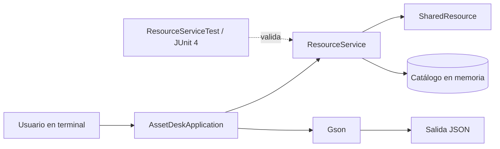
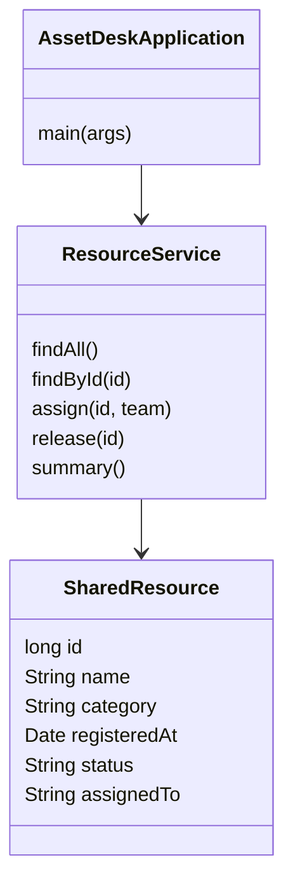
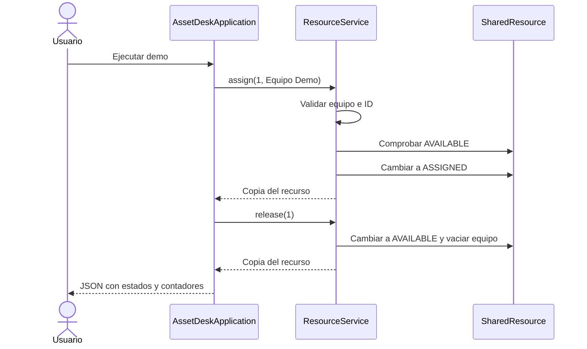
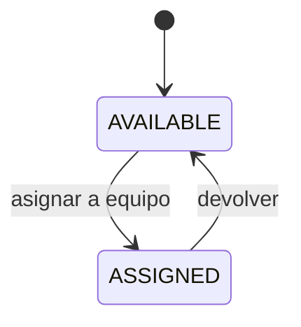

# AssetDesk · Diagramas de referencia

Estos diagramas describen el código inicial. El destino conserva las funciones, con Java 21 como objetivo. El equipo contrasta cualquier diferencia con los cambios reales del wizard.

## Componentes

## Modelo

## Asignación

## Estados

El diagrama de progreso que Bob pueda emitir describe las tareas de su workflow. Se conserva aparte de estos diagramas de arquitectura y dominio.
