# LAB 02 · RoomFlow: de JSF o Struts a React con Bob

En este workshop analizarás RoomFlow, modernizarás su interfaz con Bob y comprobarás que las reservas siguen funcionando. Sigue los pasos, compara el antes y el después y registra tus decisiones y conclusiones en `work/docs/INFORME-FINAL.md`, que prepara el script del laboratorio.

- [Contexto y objetivo](#contexto)
- [Preparación](#preparacion)
- [Pasos del laboratorio](#pasos)
- [Comparación visual y criterios de diseño](#comparacion)
- [Validación funcional](#validacion)
- [Resultados y conclusiones del ensayo](#conclusiones)
- [Entrega y cierre](#entrega)
- [Referencia técnica y resolución de problemas](#referencia-tecnica)

<a id="contexto"></a>

## Contexto y objetivo

RoomFlow es una aplicación ficticia para reservar salas de reuniones, formación o trabajo en equipo. Tu reto es renovar su interfaz y conservar las reglas que permiten solicitar, confirmar y cancelar reservas.

El objetivo es usar **UI Modernization de Bob Premium Package for Java** para separar una interfaz JSF o Struts en un frontend React y una API Java. Seguirás las opciones y preguntas del wizard, revisarás sus cambios y demostrarás que las reglas de reservas se conservan.

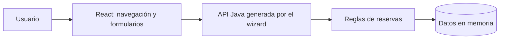

Al terminar podrás explicar qué ha cambiado en la UI, qué sigue controlando Java y qué pruebas respaldan el resultado. Si trabajas en pareja, alterna entre manejar Bob y revisar decisiones, comandos y evidencias; cambia de papel al pasar a la validación.

### Qué contiene el proyecto

| Aspecto | Variante JSF | Variante Struts |
| --- | --- | --- |
| Entrada | `legacy-jsf/` | `legacy-struts/` |
| Vistas | `index.xhtml` y `detail.xhtml` | JSP de listado y detalle |
| Adaptador web | `ReservationBean`, de sesión | `ReservationAction`, por petición |
| Configuración | `FacesServlet` y `faces-config.xml` | Filtro Struts y `struts.xml` |
| Negocio | `ReservationService` y `Reservation` | El mismo modelo y las mismas reglas |
| Entorno inicial | Java 8, Maven, WAR y Jetty | Java 8, Maven, WAR y Jetty |

Son **alternativas independientes**: cada proceso mantiene sus datos. No comparten una base de datos. El bean JSF conserva el estado de búsqueda/formulario en sesión; Struts recibe parámetros en una Action. En React, navegación, formularios y estado visual pasan al frontend; Java conserva las validaciones y transiciones.

### Reglas que hay que conservar

Las salas son **Atlas (12 plazas), Norte (8) y Taller (20)**. Al arrancar cada aplicación se cargan estas reservas:

| ID | Organizador | Sala | Fecha | Franja | Asistentes | Estado |
| --- | --- | --- | --- | --- | --- | --- |
| 1 | Ana Torres | Atlas | 2027-04-12 | MORNING | 6 | REQUESTED |
| 2 | Luis Moreno | Norte | 2027-04-12 | AFTERNOON | 4 | CONFIRMED |
| 3 | Marta Vidal | Taller | 2027-04-13 | MORNING | 12 | REQUESTED |
| 4 | Diego Ríos | Atlas | 2027-04-13 | AFTERNOON | 5 | CANCELLED |

1. El organizador es obligatorio, con un máximo de 120 caracteres tras recortar espacios.
2. La sala pertenece al catálogo; la fecha es válida en formato `AAAA-MM-DD`; la franja es `MORNING` o `AFTERNOON`. Las fechas no se comparan con el día actual.
3. Los asistentes deben estar entre 1 y el aforo de la sala.
4. Una nueva reserva nace en `REQUESTED`. Solo una pendiente puede confirmarse.
5. Se permiten solicitudes pendientes coincidentes, pero solo puede haber una **confirmada** por sala, fecha y franja.
6. Se puede cancelar una pendiente o confirmada. Una cancelación repetida se rechaza; cancelar una confirmada libera su franja.
7. La búsqueda encuentra fragmentos de sala u organizador sin distinguir mayúsculas. Un ID desconocido produce un error.

El servicio inicial sincroniza sus mutaciones y devuelve copias en las consultas. El backend debe conservar esas garantías. **No hay persistencia ni autenticación real:** reiniciar el proceso restaura los datos iniciales.

<a id="preparacion"></a>

## Preparación

Necesitas Bob con el paquete Premium para Java disponible, JDK 8 para ejecutar el legado, Maven, Node/npm y un JDK compatible con el backend que genere el wizard. Comprueba `mvn -v` para saber qué Java está usando Maven.

| Puerto de referencia | Uso |
| --- | --- |
| 8085 | Jetty del legado **o** API nueva; detén uno antes de arrancar el otro |
| 5173 | Frontend Vite del ensayo |
| 18086 | Legado en otro puerto, si lo mantienes activo para comparar |

Los comandos siguientes se ejecutan en la terminal de Bob. Las versiones, rutas y puertos pueden variar: utiliza los que produzca tu ejecución.

<a id="pasos"></a>

## Pasos del laboratorio

### 1. Preparar y arrancar una variante con Bob

Abre en IBM Bob la carpeta descomprimida del laboratorio, la que contiene `legacy-jsf/` y `legacy-struts/`. Copia este prompt y cambia **JSF** por **Struts** si prefieres esa variante.

```prompt
Prepara y arranca RoomFlow en la variante JSF siguiendo LAB.md. Identifica mi sistema operativo y mi terminal. Dime el puerto y la URL local.
```

Abre **File → Open Folder → `work/`** en Bob. Comprueba que ves el `pom.xml` y las fuentes de la variante elegida. Git Flow es opcional; si decides utilizarlo, prepara un repositorio con commit inicial antes de entrar en el wizard.

**Resultado:** una copia de trabajo identificada y un informe pendiente de completar.

### 2. Recorrer y fotografiar el antes

Como referencia para Bob, `scripts/preparar.sh` copia la variante elegida a `work/` y prepara `back/`, `front/` y el informe. Si `work/` ya existe, comprueba su variante y conserva la copia. Con Maven usando JDK 8 y el puerto 8085 libre, Bob puede ejecutar `mvn clean package` y mantener `mvn jetty:run` en una terminal integrada para que la aplicación siga activa en localhost. El arranque de referencia conserva el código y las dependencias de partida.

Abre la URL que te dio Bob. La ruta de referencia es `/roomflow/index.xhtml` para JSF o `/roomflow/reservations.action` para Struts en `http://localhost:8085`.

Localiza búsqueda, tabla, enlace **Abrir** y formulario **Nueva reserva**. **Guarda una captura antes de modificar los datos.** Esta es la referencia JSF aportada:

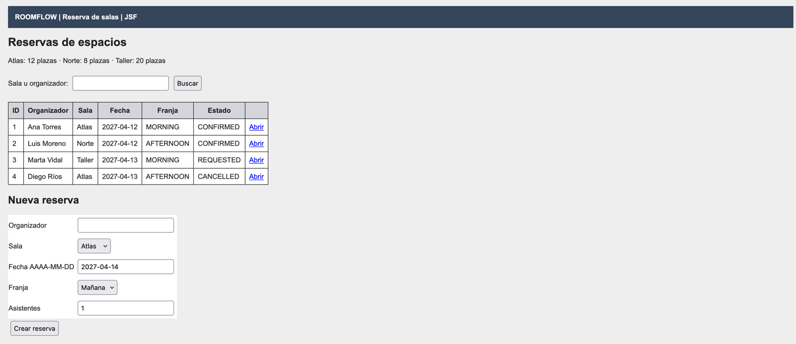

Busca **Ana**, abre la reserva 1 y comprueba sus datos con la tabla del contexto. Confírmala y cancélala para entender el recorrido. Reinicia para recuperar las cuatro reservas y detén Jetty antes de arrancar la API nueva.

**Resultado:** conoces el comportamiento que debe preservar la modernización. Si tu variante es Struts, identifica las mismas funciones en sus pantallas.

### 3. Revisar el análisis de Bob

1. En **IBM Bob Premium Package for Java**, pulsa **Ask** en **Analyze and suggest modernization**.
2. Selecciona la copia de trabajo si Bob pregunta por el proyecto.
3. Contrasta el análisis con la tabla de variantes y las reglas de esta guía.
4. Revisa framework, dependencias, pantallas, servicio de negocio y límites de los datos en memoria. Anota lo que Bob detecta y lo que no ha comprobado.

**Resultado:** puedes explicar qué se va a extraer al backend y qué asumirá React.

### 4. Elegir UI Modernization y revisar las aprobaciones

Pulsa **Start** en **UI Modernization** (o abre **Java Modernization** y elige ese tipo).

| Control o decisión | Qué seleccionar |
| --- | --- |
| Proyecto | Tu copia de RoomFlow |
| `Modernization Type` | **UI Modernization** |
| Frontend | **React** |
| Backend y design system | Elige entre las opciones disponibles y registra tu elección |
| Pantallas | Listado, búsqueda, alta y detalle; confirmar y cancelar |
| Directorios | Los que elijas cuando Bob los pregunte; anótalos |
| `Enable Git Flow` | Solo si preparaste Git; rama sugerida `workshop/roomflow-react` |
| `Continue` | Avanzar con las decisiones revisadas |

Si UI Modernization aparece deshabilitado, revisa que abriste la variante con sus fuentes y dependencias web y que el paquete está disponible. Continúa por ese flujo cuando esté disponible.

Lee los comandos antes de aprobarlos:

| Opción | Alcance |
| --- | --- |
| **Approve once** | Aprueba esa operación |
| **Approve for task** | Aprueba con el alcance indicado por Bob para esa operación/tarea; pueden aparecer otras peticiones |
| **Approve all proposed defaults and proceed** | Acepta la propuesta de arquitectura que Bob acaba de mostrar; revísala primero |

Aprobar herramientas de **Update Todo List** no implica aprobar todos los **Execute Command**. Las aprobaciones usadas en el ensayo se limitaron a la operación o tarea, sin añadir reglas globales.

**Resultado:** decisiones registradas y alcance de las herramientas entendido. No necesitas redactar una colección de prompts para recorrer el ejercicio.

### 5. Completar Backend Migration

1. Revisa el plan de extracción y sigue las subtareas de configuración, modelo/servicio, controladores, errores, CORS, OpenAPI, compilación y pruebas.
2. Comprueba que aforo, estados y conflictos siguen controlados en Java.
3. Si una compilación o prueba falla, sigue la corrección de Bob y comprueba el nuevo resultado.
4. Anota en el informe el framework, la versión Java objetivo, la carpeta del backend y su comando de arranque.

**Checkpoint manual.** Cuando Bob pregunte si la aplicación arrancó, abre **Terminal → New Terminal** y ejecuta el comando que te haya indicado, desde la carpeta del backend. Para el Spring Boot del ensayo fue:

```bash
mvn spring-boot:run
```

Deja ese terminal abierto. Abre Swagger UI, revisa reservas y salas y consulta `/v3/api-docs`. Solo después responde afirmativamente al checkpoint de Bob. Si ya habías arrancado la API, utiliza ese proceso.

**Resultado:** API accesible, reglas preservadas y pruebas revisadas.

### 6. Completar frontend y fotografiar el después

El workflow encadena estas fases:

| Fase | Qué revisar |
| --- | --- |
| **Frontend Setup** | Configuración, dependencias, cliente HTTP, tema, layout y rutas. Las pantallas de negocio pueden ser todavía placeholders |
| **Frontend Components & Home Page** | Componentes comunes, formularios, hooks, servicios y dashboard |
| **Frontend Pages & Backend Integration** | Listado, alta, detalle y acciones conectados a la API |
| **Validation** | Compilación, comprobaciones y recorridos del resultado |

En Setup, revisa la propuesta de frontend, design system, navegación, estado y proxy. Acepta los defaults si encajan con las decisiones que has registrado. Comprueba después `package.json` y el lockfile: lo instalado puede diferir de la propuesta.

**Checkpoint manual de frontend.** Abre un **segundo terminal** en el directorio del frontend y ejecuta el comando generado; en el ensayo fue:

```bash
npm run dev
```

Abre la URL indicada (en el ensayo, `http://localhost:5173/`), comprueba la carga y cambia entre tema claro y oscuro. Verifica que `/api/rooms` devuelve las salas a través de Vite. Una pantalla de Setup con placeholders no es aún el resultado funcional: continúa con las fases siguientes.

Cuando terminen componentes e integración, abre **Inicio**. Con los datos iniciales, revisa **4 reservas: 2 solicitadas, 1 confirmada y 1 cancelada**, las tres salas y las solicitudes pendientes. Guarda tu captura del resultado.

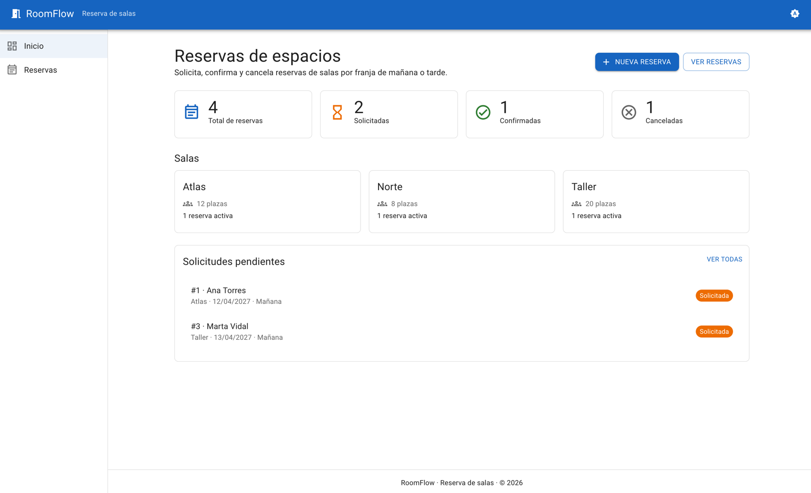

Pulsa **Reservas** o **Ver reservas**: allí deben seguir disponibles búsqueda, listado, alta y acceso al detalle. Revisa las peticiones reales a la API en Network.

**Resultado:** frontend compilado y conectado al backend. Conserva ambos terminales abiertos; evita arrancar procesos duplicados.

<a id="comparacion"></a>

### 7. Comparar el antes y el después

| Qué revisar | Antes: JSF o Struts | Después del ensayo: React/MUI |
| --- | --- | --- |
| Entrada | Listado, búsqueda y alta | Dashboard con contadores, salas y solicitudes pendientes |
| Navegación | Abrir reserva y volver al listado | Inicio/Reservas, migas de pan y acceso al detalle |
| Estados | `REQUESTED`, `CONFIRMED`, `CANCELLED` | Solicitada, Confirmada y Cancelada, con texto además de color |
| Tabla | Presentación básica | Ordenación, paginación y acciones visibles |
| Formulario | Controles básicos | Ayudas de aforo, fecha y asistentes; validación junto al campo |
| Cancelación | Acción desde el detalle | Diálogo de confirmación antes de cancelar |
| Tema | Único | Claro/oscuro/sistema |
| Negocio | Aforo, estados y conflicto en Java | Las mismas reglas, invocadas mediante la API |

Las dos imágenes aportadas muestran vistas distintas: listado JSF e inicio React. Ana aparece **CONFIRMED** en la primera y **Solicitada** en la segunda. Para comprobar las reglas, usa los mismos datos y estados iniciales en tus comparaciones. El ensayo documentado migró **Struts**; la imagen JSF es una referencia visual de la otra variante.

**Revisión del diseño:** comprueba etiquetas claras, espaciado coherente, estados con texto, carga/vacío/error/éxito visibles, prevención del doble envío, campos etiquetados y errores asociados a cada control. Prueba escritorio y pantalla de 390 px. El resultado de otra ejecución puede tener un aspecto diferente y conservar correctamente el recorrido.

<details>
<summary>Ver las capturas comparables del ensayo Struts y la vista móvil</summary>

Listado original y listado React con las mismas cuatro reservas de partida:

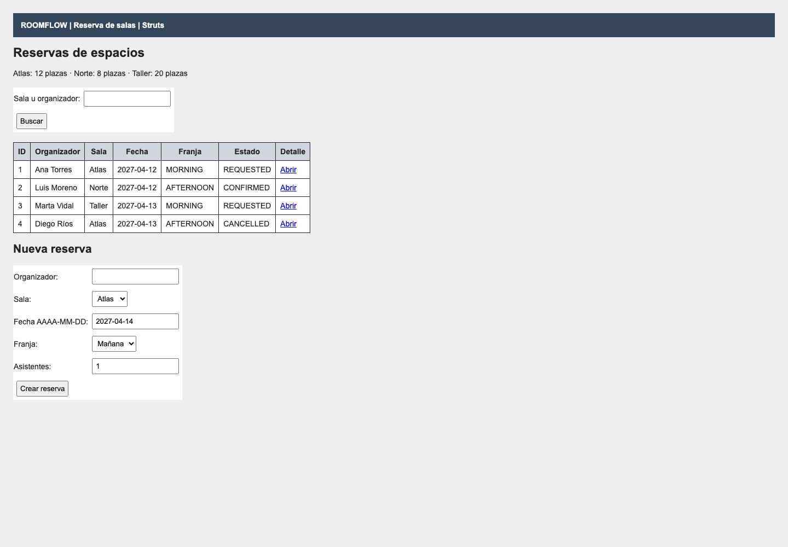

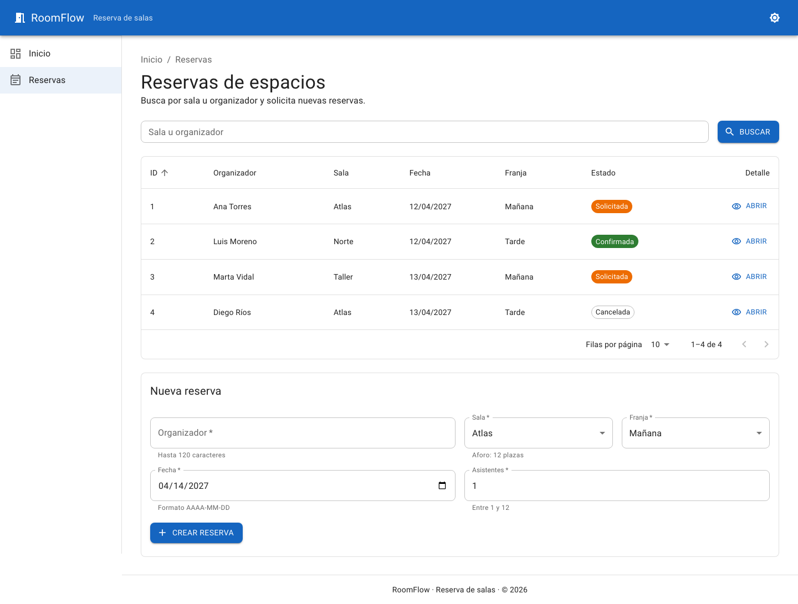

Detalle original y detalle React:

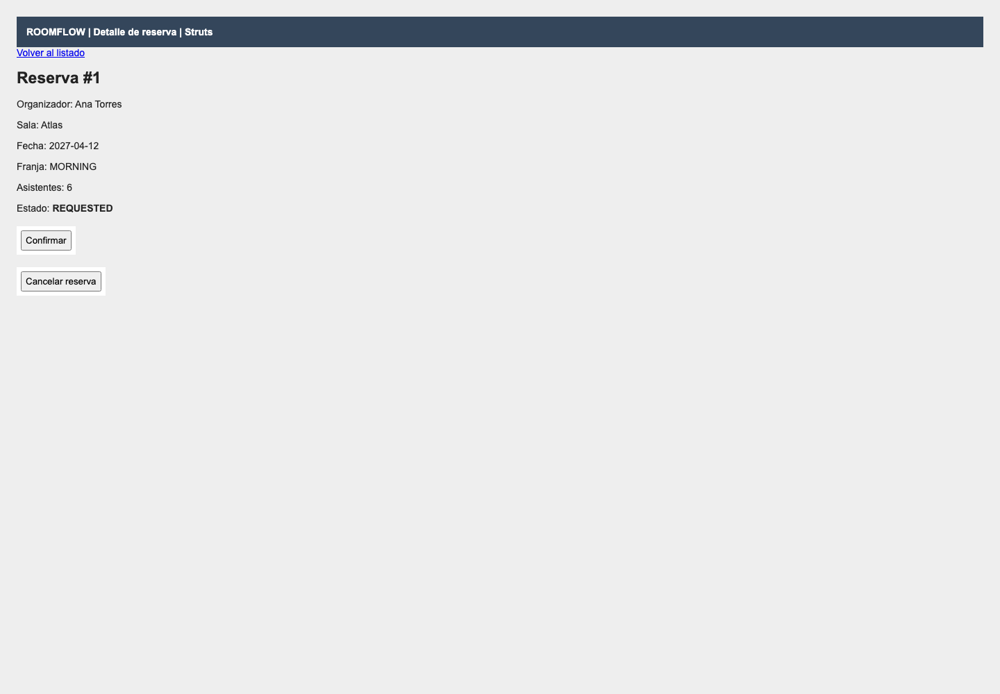

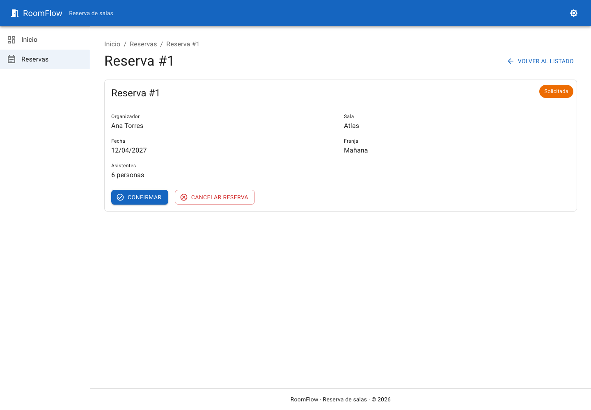

En móvil, el viewport era de 390 px. El documento original medía 536 px; el nuevo, 390 px. La tabla nueva conserva scroll interno (356 px visibles de 719 de contenido); no se convirtió en tarjetas. Son medidas de disposición, no de rendimiento.

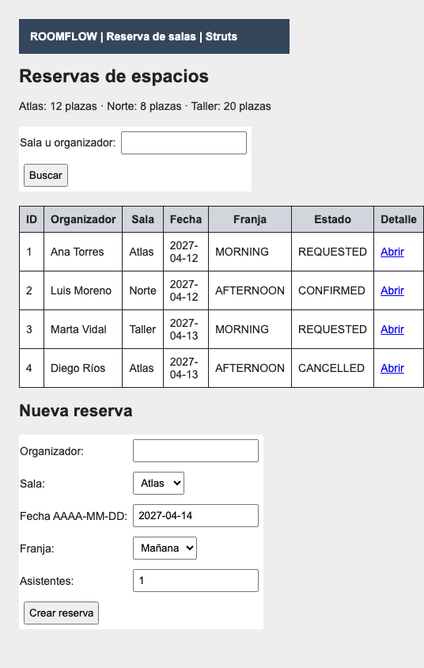

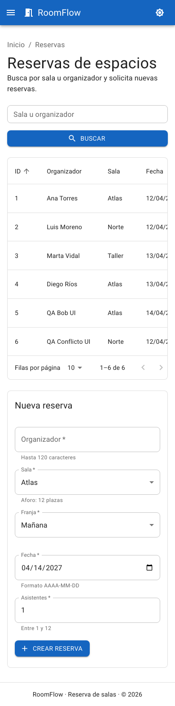

La captura móvil nueva incluye seis filas tras las pruebas y muestra Marta confirmada: sirve para comparar el ancho, no los estados iniciales. El campo de fecha nativo puede mostrar otro formato según el navegador, aunque la API reciba `AAAA-MM-DD`.

</details>

<a id="validacion"></a>

### 8. Validar las reglas y la recuperación

Empieza con los datos iniciales. Anota **EJECUTADO OK**, **FALLIDO** o **NO EJECUTADO**, junto con la evidencia de cada caso. Si Bob ya añadió datos de prueba, consérvalos en el informe antes de reiniciar únicamente tu API para recuperar la referencia.

| Acción | Resultado esperado |
| --- | --- |
| Abrir Inicio, listado y detalle de Ana | Cuatro reservas y tres salas; datos de la reserva 1 correctos |
| Buscar `aNa` | Solo Ana Torres |
| Buscar texto inexistente | Estado vacío explicado |
| Solicitar Atlas para 13 asistentes | Rechazo por aforo |
| Crear Atlas, 2027-04-14, MORNING, 4 personas | Nueva reserva REQUESTED; ID 5 si no hubo otras altas |
| Confirmarla y recargar | CONFIRMED conservado por la API |
| Cancelarla, aceptar el diálogo y recargar | CANCELLED; la franja queda libre |
| Crear Norte, 2027-04-12, AFTERNOON, 4 y confirmar | Alta permitida y confirmación rechazada: ya está confirmada la reserva 2; la nueva sigue REQUESTED |
| Cancelar una confirmada y confirmar otra pendiente para su franja | La franja liberada permite la nueva confirmación |
| Abrir `/reservations/99999` | Reserva no encontrada y opción de recuperación |
| Detener tu API desde su terminal y consultar | Error visible y Reintentar, sin datos simulados |
| Arrancar de nuevo tu API y pulsar Reintentar | Vuelven los datos y el formulario; al reiniciar se restaura el estado inicial |
| Primer Tab en Inicio y Enter sobre Saltar al contenido | El foco pasa al `main`, no solo cambia la URL |
| Navegar con teclado y usar un viewport de 390 px | Controles utilizables y foco visible; documenta cualquier límite |

Comprueba también que intentar confirmar una cancelada o repetir una cancelación se rechaza. Distingue el resultado de las pruebas automáticas de los recorridos manuales: una captura de una pantalla no sustituye una prueba de la acción.

**Resultado:** puedes demostrar una reserva completa y un rechazo real por conflicto, con sus evidencias.

<a id="conclusiones"></a>

## Resultados y conclusiones del ensayo

Usa este ejemplo de **IBM Bob 2.3.0 con entrada Struts** para contrastar tu ejecución. Las evidencias cubren la generación de backend, frontend y su validación. Los archivos de análisis y opciones ya estaban disponibles al iniciar esa sesión; sus pasos iniciales no están documentados en las capturas.

### Qué generó Bob

| Capa | Resultado observado |
| --- | --- |
| Backend | Spring Boot 3.5.16, Java objetivo 17, springdoc 2.8.17 |
| Frontend | React 19.3.1, MUI 9.6.0, Router 7.18.6, Vite 8.3.8, TypeScript 7.0.2, Axios 1.21.1 |
| Estructura | Backend y frontend en la raíz de la copia de trabajo; `legacy-struts/` permaneció anidado |
| Estado de los datos | En memoria; reiniciar la API restaura las cuatro reservas |
| Autenticación | Base de configuración desactivada; sin autenticación real |
| Cierre | Bob mostró All tasks completed y un Mermaid de resumen del workflow |

MUI 7 apareció en la propuesta, pero se resolvió MUI 9.6.0. No se seleccionaron Java 21, Carbon ni Quarkus. `back/` y `front/` eran sugerencias de destino, no un requisito del resultado.

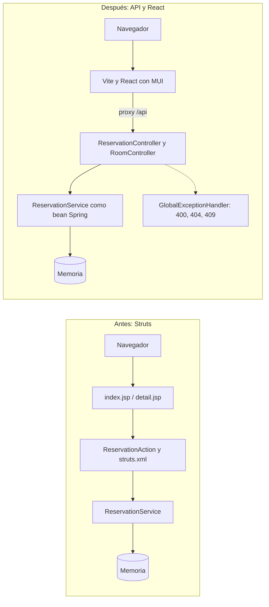

Las clases `Reservation` y `ReservationService` generadas se conservaron idénticas a las del legado. La comprobación de integridad encontró 14 archivos heredados sin cambios: [evidencia de integridad](referencia/sesion-bob/legacy-integridad-final.json).

### Qué se comprobó y qué quedó fuera

| Tipo | Resultado del ensayo | Evidencia |
| --- | --- | --- |
| Entradas JSF y Struts | Build y recorridos del legado revisados previamente con JDK 8 | Son validaciones de partida, no migraciones de ambas variantes |
| Tests automáticos backend | 7 tests MockMvc, 0 fallos, 0 errores y 0 omitidos | [Surefire](referencia/sesion-bob/backend-tests.txt) |
| Frontend | Lint y build correctos tras las correcciones | Comprobados durante el workflow; no había suite `test` frontend |
| Búsqueda, alta, estados y recarga | Recorridos manuales correctos | [Búsqueda](referencia/sesion-bob/qa-busqueda.txt), [confirmación](referencia/sesion-bob/qa-confirmada-refresco.txt), [cancelación](referencia/sesion-bob/qa-cancelada-refresco.txt) |
| Aforo y conflicto | Rechazos correctos; el conflicto conserva REQUESTED | [Aforo](referencia/sesion-bob/qa-aforo.txt), [conflicto](referencia/sesion-bob/qa-conflicto.json) |
| API apagada y recuperación | Error visible; Reintentar recuperó datos y formulario | [Error](referencia/sesion-bob/qa-backend-apagado.txt), [recuperación](referencia/sesion-bob/qa-backend-recuperado.json) |
| Enlace de salto | Falló inicialmente y pasó tras corregir el foco | [Antes](referencia/sesion-bob/qa-salto-contenido-antes.json), [después](referencia/sesion-bob/qa-salto-contenido.json) |
| Fuera de la validación ejecutada | Migración JSF, teclado completo y auditorías de accesibilidad, rendimiento y seguridad | No se presentan como comprobados |

### Qué aprendemos para otra modernización

1. **Cambian las responsabilidades de presentación.** React asume navegación y formularios; Java sigue decidiendo si se permite una reserva o un cambio de estado.
2. **El wizard requiere revisión y comprobaciones.** Setup puede arrancar con pantallas incompletas; las versiones instaladas pueden diferir de la propuesta y una compilación puede necesitar correcciones.
3. **La integración se demuestra ejecutando acciones.** Crear, confirmar, recargar y provocar un conflicto aporta evidencia que el aspecto visual por sí solo no proporciona.
4. **Los límites deben quedar escritos.** Este ejercicio conserva datos en memoria y carece de autenticación real. Persistencia, identidad corporativa, pruebas frontend y despliegue son decisiones posteriores.

<details>
<summary>Ver evidencias del wizard y del cierre</summary>

[Decisiones de frontend](referencia/sesion-bob/05-decisiones-frontend.png) · [Corrección de build MUI](referencia/sesion-bob/06-correccion-build-mui.png) · [Setup con placeholders](referencia/sesion-bob/intermedio-setup.png) · [Swagger](referencia/sesion-bob/backend-swagger.png) · [Workflow completado](referencia/sesion-bob/09-workflow-completado.png).

</details>

<a id="entrega"></a>

## Entrega y cierre

Completa `work/docs/INFORME-FINAL.md` con tus decisiones y resultados. El script lo crea a partir de la plantilla incluida aquí. Adjunta las capturas de antes y después, tu Mermaid revisado y las salidas de las pruebas. Documenta lo que obtengas en tu ejecución y utiliza el ejemplo anterior para contrastar tus conclusiones.

Demuestra una confirmación y un rechazo por conflicto. Revisa el Mermaid de resumen que muestra Bob al terminar Validation. Si usaste Git Flow, conserva la rama o el diff. Mantén API y Vite activos durante la demostración y detén tus procesos desde sus terminales al finalizar.

- [ ] Variante, análisis y decisiones del wizard registrados.
- [ ] Backend y frontend compilados y conectados.
- [ ] Recorrido de reserva, aforo, conflicto y recuperación comprobados.
- [ ] Capturas de antes y después comparadas con el mismo estado de datos.
- [ ] Pruebas automáticas y manuales distinguidas; fallos y casos no ejecutados indicados.
- [ ] Conclusiones y siguiente paso explicados con evidencias.

<details>
<summary>Plantilla del informe final (el script la copia automáticamente)</summary>

<!-- ROOMFLOW_INFORME_INICIO -->
```markdown
# Informe final · RoomFlow

Equipo y fecha: PENDIENTE

## Contexto y decisiones

Qué hacía la aplicación, variante JSF/Struts, versión de Bob y opciones realmente elegidas.
Frontend, backend, Java objetivo, design system, versiones resueltas y directorios generados: PENDIENTE.
Git Flow y alcance de aprobaciones utilizado: PENDIENTE.

## Antes y después

Capturas del mismo estado de datos, cambios de navegación/diseño y funciones conservadas: PENDIENTE.

## Arquitectura

Mermaid revisado, responsabilidades de React/Java y trazabilidad de las reglas: PENDIENTE.

## Validaciones

| Caso | Estado | Resultado y evidencia |
| --- | --- | --- |
| Builds y pruebas automáticas | NO EJECUTADO | PENDIENTE |
| Búsqueda, alta y detalle | NO EJECUTADO | PENDIENTE |
| Confirmación/cancelación con recarga | NO EJECUTADO | PENDIENTE |
| Aforo, conflicto y liberación de franja | NO EJECUTADO | PENDIENTE |
| Estados inválidos y detalle inexistente | NO EJECUTADO | PENDIENTE |
| API apagada y recuperación | NO EJECUTADO | PENDIENTE |
| Tema, móvil, teclado y foco | NO EJECUTADO | PENDIENTE |

Usa EJECUTADO OK, FALLIDO o NO EJECUTADO. Separa pruebas automáticas y recorridos manuales.

## Conclusiones

Qué cambió, qué se preservó, incidencias corregidas y límites: PENDIENTE.
Qué falta para un siguiente paso y qué no se ha medido: PENDIENTE.

Guía del laboratorio: [LAB.md](../../LAB.md).
```
<!-- ROOMFLOW_INFORME_FIN -->

</details>

<a id="referencia-tecnica"></a>

## Referencia técnica y resolución de problemas

Esta sección es de consulta; sigue los pasos anteriores para realizar la práctica.

<details>
<summary>Arquitectura de las variantes, frontend y confirmación</summary>

Inventario inicial: JSF/Mojarra 2.2.20 o Struts 2.5.33, Servlet 3.1 y Jetty Maven Plugin 9.4.57. Ambas variantes usan Java 8 y Maven.

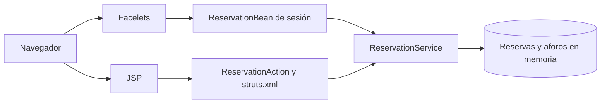

Las ramas son aplicaciones alternativas; cada una tiene su propio proceso y almacenamiento.

Estados válidos:

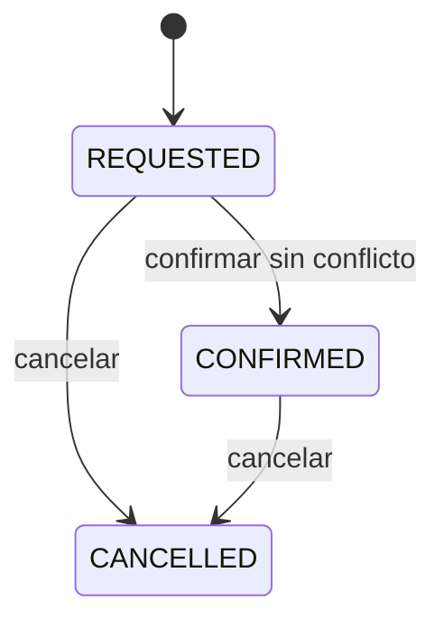

Capas del frontend generado en el ensayo:

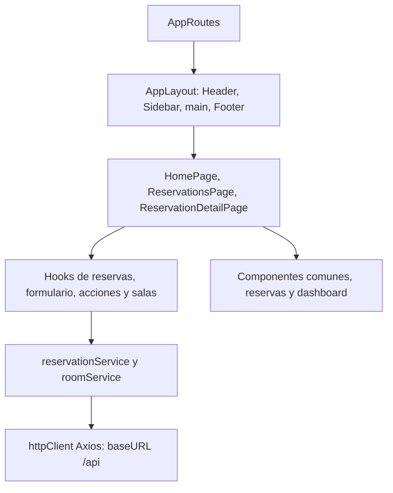

Las páginas se cargan de forma diferida. Las rutas incluyen `/`, `/reservations`, `/reservations/:id`, `/login` y la página 404. La entrada antigua `/reservations.action` redirige al listado. `VITE_AUTH_ENABLED` estaba desactivado: disponer de una ruta de login no equivale a haber implementado autenticación.

Confirmación en la API del ensayo:

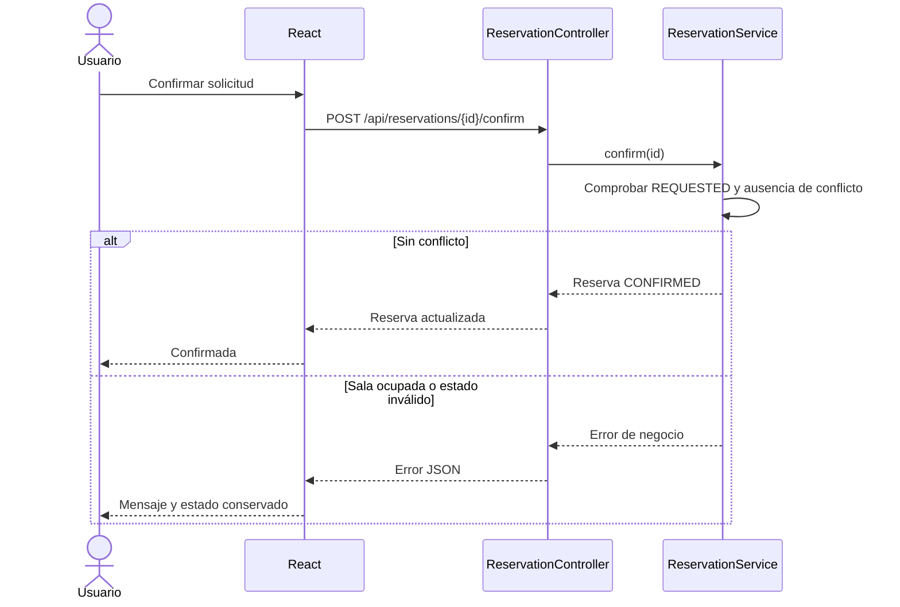

</details>

<details>
<summary>Endpoints y proxy del ensayo</summary>

| Método y ruta | Uso | Error esperado |
| --- | --- | --- |
| `GET /api/reservations?search=...` | Listado y búsqueda | — |
| `GET /api/reservations/{id}` | Detalle | 404 si no existe |
| `POST /api/reservations` | Alta | 400 si incumple las reglas |
| `POST /api/reservations/{id}/confirm` | Confirmar | 409 por conflicto o estado inválido |
| `POST /api/reservations/{id}/cancel` | Cancelar | 409 si ya estaba cancelada |
| `GET /api/rooms` | Catálogo de salas | — |

La API del ensayo usó `127.0.0.1:8085`, OpenAPI en `/v3/api-docs` y Swagger UI en `/swagger-ui.html`. Vite reenvía `/api` y `/v3/api-docs` al backend; CORS permite también los orígenes locales del frontend en el puerto 5173. Usa las rutas que produzca tu ejecución.

</details>

<details>
<summary>Incidencias y alternativas de arranque</summary>

| Situación | Qué hacer |
| --- | --- |
| Maven usa un Java distinto del esperado | Revisa `mvn -v` y el JDK configurado para esa terminal. El ensayo compiló con objetivo 17 usando un JDK Homebrew 27; no fue una validación de ejecución en JDK 17 |
| El backend no arranca en 8085 | Revisa que tu Jetty antiguo esté detenido y que no haya otra API de la práctica activa |
| El frontend arranca con placeholders | Completa Components y Pages & Backend Integration antes de validar el negocio |
| Error al compilar React | Revisa el mensaje y las versiones resueltas; deja que Bob aplique la corrección y repita la comprobación |
| Un servicio deja de responder tras un comando de Bob | Arráncalo en su propio terminal integrado, en primer plano, y mantenlo abierto |
| Una captura tiene más reservas o estados distintos | Las pruebas pueden haber modificado los datos; documenta el estado y recupera la referencia antes de una comparación equivalente |
| Saltar al contenido solo cambia el hash | Comprueba el foco real. En el ensayo Bob añadió `tabIndex={-1}` al main y foco explícito en el enlace |

En el ensayo, los intentos de background con `&` y `nohup` no persistieron al terminar el ejecutor de Bob. Funcionaron dos terminales integrados con la API y Vite en primer plano. Los scripts `start-backend.sh`/`start-frontend.sh` se generaron para esa ejecución y pueden no existir en otra.

Para ejecutar el legado con Docker en lugar de un JDK 8 local, sitúate en la copia que contiene su `pom.xml`:

```bash
docker run --rm -p 127.0.0.1:8085:8085 \
  --mount "type=bind,source=$PWD,target=/workspace" \
  --mount type=volume,source=bobathon-maven-cache,target=/root/.m2 \
  -w /workspace maven:3.9-eclipse-temurin-8 \
  mvn jetty:run -Djetty.http.host=0.0.0.0
```

Detén ese servidor al pasar al backend nuevo, o publica el legado en otro puerto si quieres comparar ambas aplicaciones en paralelo.

</details>
